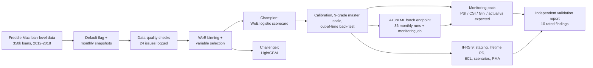
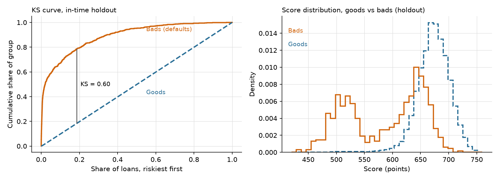
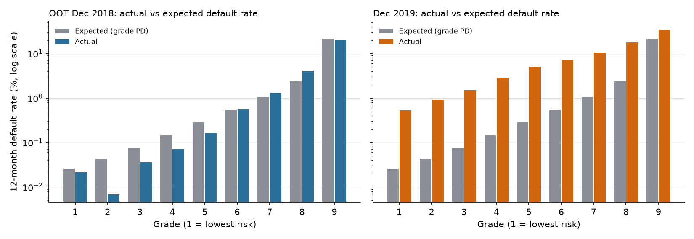
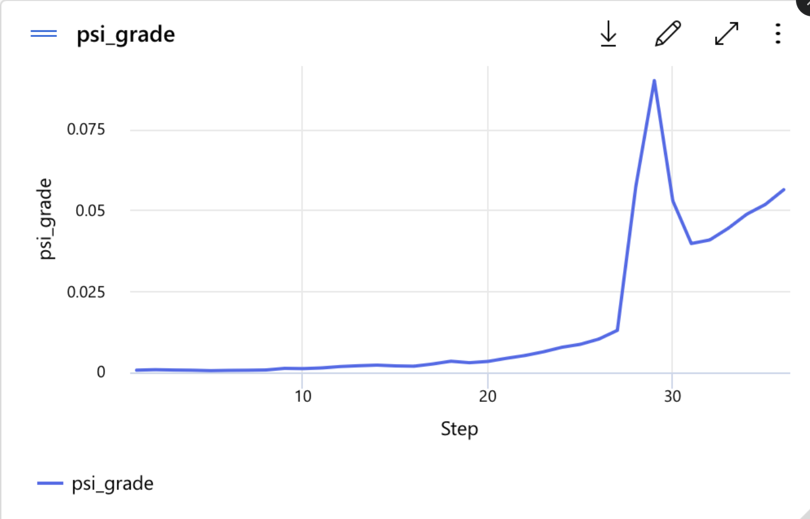
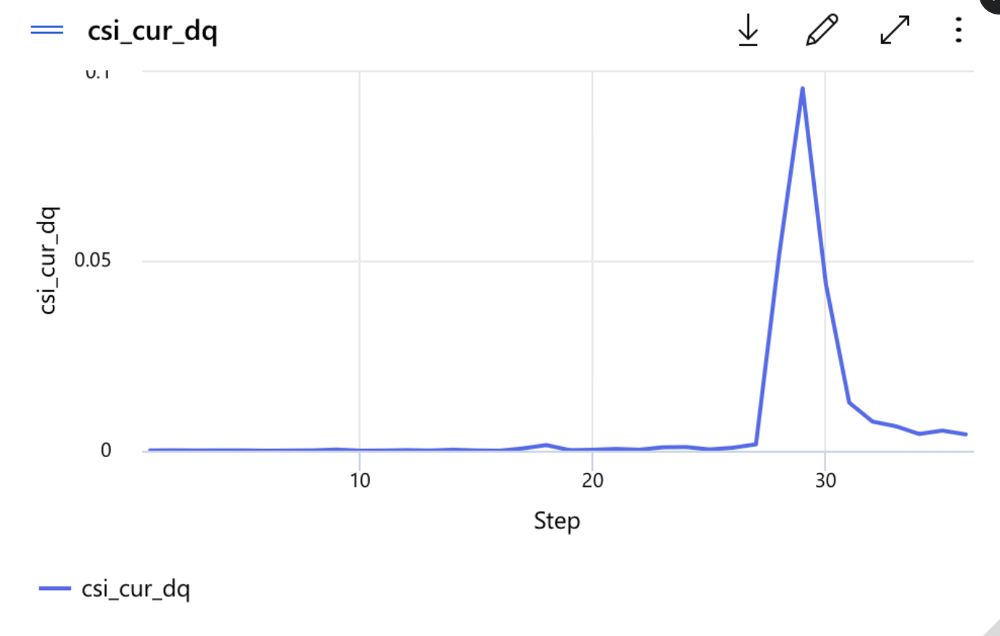
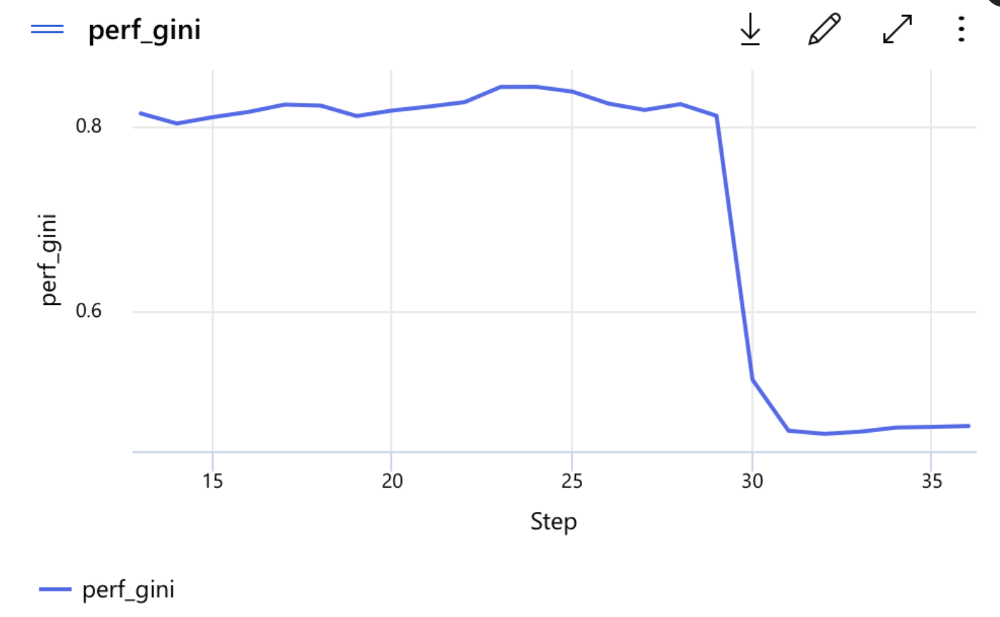
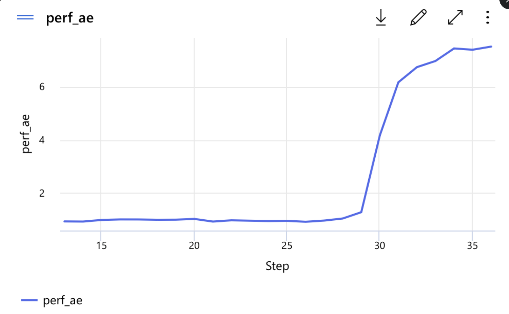
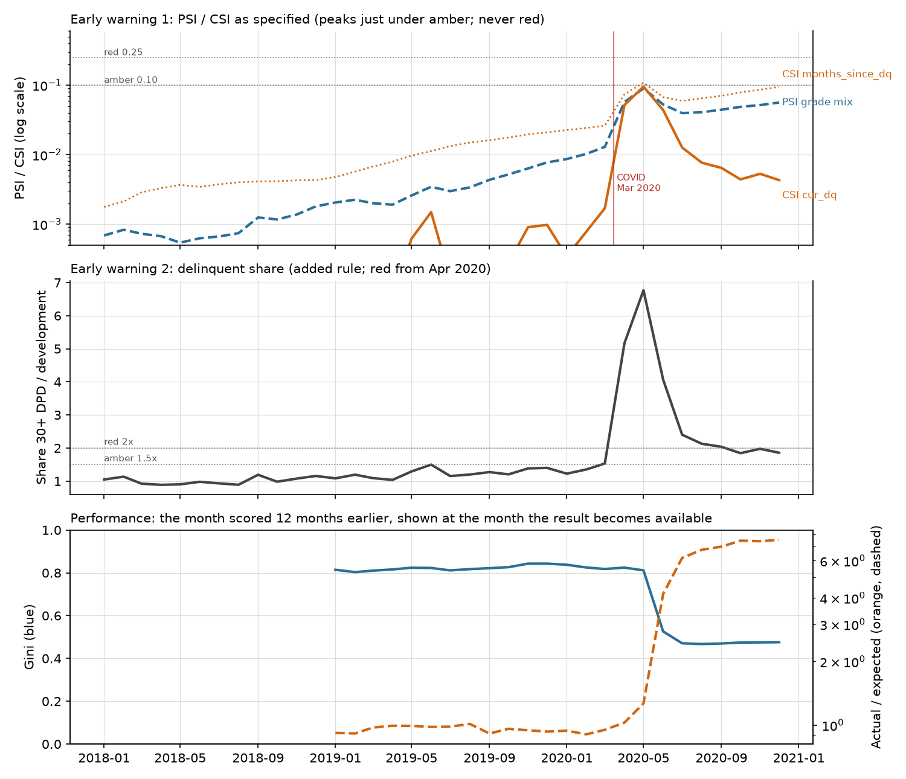

<div align="center">

# 12-Month Mortgage PD Model

**A probability-of-default scorecard for US mortgages, with an independent validation review,
a monitoring pack, an IFRS 9 ECL extension and an Azure ML deployment.**


</div>

Built on Freddie Mac's public Single-Family Loan-Level Dataset (50,000-loan samples, 2012 to 2018 vintages).
It covers what a credit-risk team does end to end: **develop** the model, **validate** it as a second-line reviewer would,
**monitor** it through a stress period, and **extend** it to IFRS 9 expected credit loss.

> **Integrity note.** I developed *and* validated this model myself, so the review is an exercise in independence, not true independence.
> No raw loan data is in this repository: only code and aggregated results.

---

## 📊 Results at a glance

| Area | Result | |
|---|---|---|
| **Discrimination (Gini)** | train 0.803 · holdout 0.784 · **out-of-time (Dec 2018) 0.843** · 0.72 on loans that were current | 🟢 |
| **Calibration, OOT** | actual 0.449% vs expected 0.482% (ratio 0.93) | 🟢 |
| **Grade back-test, OOT** (9 grades) | 7 Green · 1 Amber (grade 7) · 1 Red (grade 8: observed 4.03% vs PD 2.38%) | 🟡 |
| **Champion vs challenger** | scorecard beats LightGBM: OOT Gini 0.843 vs 0.831, train-to-holdout gap 0.019 vs 0.083 | 🟢 |
| **Monitoring, Dec 2019 (COVID)** | grade-mix PSI 0.0077 🟢 · Gini 0.476 🔴 · actual/expected 7.53 🔴 | 🔴 |
| …after adjusting for forbearance | Gini 0.805 🟢 · actual/expected 0.86 🟢 (see *What COVID did* below) | 🟢 |
| **IFRS 9** (Dec 2019, $42.3bn sample) | probability-weighted ECL **$60.5m**, coverage **0.143%** (upside $53.1m · base $55.7m · downside $73.5m) | 🟡 |
| **Azure ML** | 36 monthly batch runs + 36 monitoring runs · total cost **GBP 1.42** | 🟢 |
| **Overall validation rating** | **Fit for use with conditions** (10 findings: 2 High, 7 Medium, 1 Low) | 🟠 |

## 🧭 How the project fits together



## 🖼️ Key charts

<table>
<tr>
<td width="50%"><br><sub><b>Discrimination:</b> KS curve and goods-vs-bads score distribution (in-time holdout).</sub></td>
<td width="50%"><br><sub><b>Calibration:</b> actual vs expected by grade, OOT Dec 2018 (left) and COVID Dec 2019 (right).</sub></td>
</tr>
</table>

## 🔎 Validation findings (full detail in the [report](reports/Validation_Report.pdf))

| ID | Severity | Finding | Key evidence |
|---|---|---|---|
| F1 | 🔴 High | Calibration anchor excludes a downturn | Development windows all had falling unemployment (-0.3, -0.6, -0.2 pp) |
| F2 | 🔴 High | Model and monitoring misread COVID forbearance | 8,466 of 9,059 Dec 2019 "defaults" were forborne; only 136 ended in a credit event |
| F3 | 🟠 Medium | Grades 7-8 under-predicted, grades 3-5 and 9 over-predicted | Grade 8 observed 4.03% vs 2.38% PD (p < 0.0001) |
| F4 | 🟠 Medium | OOT sample not independent by borrower | 80.7% of OOT loans are also development loans |
| F5 | 🟠 Medium | Prepayment ignored in EAD | 12.7% of loans prepay within 12 months |
| F6 | 🟠 Medium | LGD assumed, not estimated | Weighted ECL $30.3m at 5% LGD, $121.1m at 20% |
| F7 | 🟠 Medium | Lifetime PD and staging simplifications | 52% of ECL from the 1% of loans 30+ days past due |
| F8 | 🟠 Medium | Macro link weak and contaminated | β = 0.18, Newey-West s.e. 0.062, R² 0.40 |
| F9 | 🟠 Medium | Monitoring thresholds as specified missed COVID | Peak grade-mix PSI 0.090 (amber line 0.10) |
| F10 | 🟢 Low | Sparse grades and thin variables | Grade 1 has 3 OOT defaults, grade 2 has 1 |

## 🦠 What COVID did, and what the monitoring saw

The Dec 2019 snapshot's 12-month outcome window falls in 2020. Reported defaults jumped to 3.99% (7.5× expected), but **93.5% of those
defaults were forborne loans, and 93.6% cured or paid off**. Payment holidays were counted as defaults by the 90-day rule. With forborne-then-cured
loans treated as non-defaults, Gini returns to 0.805 and actual/expected to 0.86.

I replayed 36 month-ends (Jan 2018 to Dec 2020) through an Azure ML batch endpoint and a monitoring job. The standard drift signals
(grade-mix PSI, CSI at 0.10 / 0.25) **never alerted** (peak PSI 0.090). A delinquent-share rule, added after seeing the data, went Red in April 2020;
performance alerts followed in May and June, because outcomes need 12 months to mature.

<table>
<tr>
<td width="50%"></td>
<td width="50%"></td>
</tr>
<tr>
<td width="50%"></td>
<td width="50%"></td>
</tr>
</table>
<sub>Azure ML Studio metrics from the monitoring runs (x-axis: step 1 = Jan 2018, step 36 = Dec 2020). Performance starts at step 13 because of the 12-month label delay.</sub>



---

<details>
<summary><b>🏗️ Model documentation</b> (default definition, samples, method, calibration, master scale)</summary>

**Default definition.** 90+ days past due, REO acquisition, or zero-balance code 02, 03, 09 or 15 (third-party sale, short sale or charge-off, REO disposition, note sale), within 12 months of the snapshot. Loans already in default or terminated at the snapshot are excluded.

**Samples** (time-based; the development split is 70/30 by loan, seed 42):

| Sample | Snapshots (outcome window) | Loan-snapshots | Defaults | Default rate |
|---|---|---|---|---|
| Development | Dec 2015, 2016, 2017 (2016-2018) | 585,900 | 2,661 | 0.454% |
| Out-of-time | Dec 2018 (2019) | 254,118 | 1,141 | 0.449% |
| Monitoring | Dec 2019 (2020, COVID) | 227,165 | 9,059 | 3.99% |

**Method.** Champion: logistic regression on weight-of-evidence (WoE) bins (optbinning, monotone, own bin for missing), scored on a 600-points-at-50:1, 20-points-to-double scale.
Twenty candidates screened by IV, direction, stability across snapshots, correlation and VIF. Nine variables, all with positive coefficients (p < 0.001):
months_since_dq 0.60, cur_dq 0.29, fico 0.49, cltv 0.40, dti 0.31, orig_rate 0.23, ever_modified 0.28, n_borrowers 0.82, upb_ratio 0.50 (intercept -5.33).
Challenger: LightGBM with monotone constraints.

**Calibration.** Intercept shifted by -0.0152 so the mean PD on development equals its observed default rate (0.4542%). The anchor covers 2016 to 2018 only (finding F1).

**Master scale** (grade 1 = lowest risk; edges fixed on development):

| Grade | PD range | Grade PD | Loans | Defaults |
|---|---|---|---|---|
| 1 | 0.012% to 0.035% | 0.026% | 29,890 | 2 |
| 2 | 0.035% to 0.050% | 0.043% | 34,689 | 5 |
| 3 | 0.050% to 0.100% | 0.075% | 125,824 | 40 |
| 4 | 0.100% to 0.200% | 0.145% | 173,961 | 170 |
| 5 | 0.200% to 0.400% | 0.280% | 131,937 | 393 |
| 6 | 0.400% to 0.800% | 0.539% | 61,273 | 438 |
| 7 | 0.800% to 1.600% | 1.064% | 16,341 | 226 |
| 8 | 1.600% to 3.999% | 2.376% | 6,022 | 195 |
| 9 | 4.001% to 88.170% | 21.371% | 5,963 | 1,192 |

Every decision, with its alternative and reason, is in [decisions.md](decisions.md); every metric exactly as printed by the code is in [results.md](results.md).

</details>

<details>
<summary><b>💶 IFRS 9 extension</b> (staging, lifetime PD, ECL, scenarios, post-model adjustment)</summary>

Dec 2019 portfolio of the sample: 227,165 loans, $42.3bn. All scenario weights, shocks and the 10% LGD are my illustrative assumptions.

| | Result |
|---|---|
| Staging | Stage 1: 219,026 loans ($40.70bn) · Stage 2: 8,139 loans ($1.57bn, 3.7%) · Stage 3 out of scope |
| ECL by scenario (LGD 10%) | Upside $53.14m (20%) · Base $55.69m (50%) · Downside $73.54m (30%) |
| Probability-weighted ECL | **$60.54m**, coverage 0.143% |
| LGD sensitivity (weighted) | 5%: $30.27m · 10%: $60.54m · 20%: $121.07m |
| Unemployment link | β = 0.1817 (Newey-West s.e. 0.0623, R² 0.40); pre-COVID β = 0.3049 |
| Post-model adjustment | +$1.3m (+2.4%) for the grade-slope miscalibration; about -$115m would offset a mechanical recalibration to reported 2020 defaults |

Weighted ECL exceeds base by $4.85m: $4.31m because the scenario weights are skewed to the downside, $0.54m from convexity.

</details>

<details>
<summary><b>⚠️ Limitations</b></summary>

- Calibration anchor covers a benign period; no downturn.
- The 90-day default rule counts forborne loans; the adjusted view uses outcome data to March 2026 (hindsight).
- OOT loans overlap development loans (80.7%): later in time, not independent by borrower. The sample is 350,000 loans, not a whole book.
- Back-test p-values assume independent defaults.
- IFRS 9 extension: no prepayment in EAD, LGD assumed at 10%, hazard flat beyond loan age 6, relative risk persists for life, staging fixed across scenarios, scenarios and weights illustrative, weak unemployment link.
- Monitoring thresholds are my choice; the delinquent-share rule, the three-red-grade alert and the `upb_ratio` exclusion were set after seeing the data.
- Single developer and validator.

</details>

<details>
<summary><b>▶️ How to reproduce</b></summary>

1. **Data.** Follow [data/raw/README.md](data/raw/README.md) (free Freddie Mac registration; raw files stay private).
2. **Environment.** Python 3.12: `python -m venv .venv && source .venv/bin/activate && pip install -r requirements.txt`. Random seed 42 throughout.
3. **Run order** (from the repository root):

```
python -I src/run_step1.py      # load, default flag, snapshots
python -I src/run_step2.py      # samples and exclusions waterfall
python -I src/run_step3.py      # data quality
python -I src/run_step4a.py && python -I src/run_step4b.py                              # WoE bins and selection
python -I src/run_step5.py      # champion scorecard
python -I src/run_step6.py      # challenger
python -I src/run_step7.py && python -I src/run_step7_extra.py                          # calibration, master scale, OOT back-test
python -I src/perf_ext.py && python -I src/run_step8.py && python -I src/run_step8b.py  # MI pack
python -I src/run_step9a.py && python -I src/run_step9b.py && python -I src/run_step9c.py  # IFRS 9
python src/make_validation_report.py   # report PDF and findings summary
pytest tests                           # 14 tests
```

A full re-run from the raw files into an empty `data/interim` reproduced Steps 2 to 9 of `results.md` line for line.

4. **Azure ML** (optional): [azure_ml/IMPLEMENT.md](azure_ml/IMPLEMENT.md). Total cost for my run was GBP 1.42.

</details>

---

## 🗺️ Repository map

```
pd-mortgage/
├── README.md                  ← you are here
├── decisions.md               every decision: what I chose, the alternative, why
├── results.md                 every metric exactly as the code printed it
├── reports/
│   ├── Validation_Report.pdf  4-page independent validation report (SS1/23 style)
│   ├── MI_pack.pdf            monitoring pack, one page per test with a RAG status
│   └── *.png, scorecard_points.csv   charts and the final points table (no loan-level data)
├── src/                       reusable code (woe.py, scorecard.py, metrics.py ...) and run_step*.py
├── notebooks/                 01_load ... 09_ifrs9: one per step, in run order
├── tests/                     pytest: psi, gini, WoE transform, scorecard scaling, batch scorer
├── azure_ml/                  batch deployment, monitoring job, runbook, step-by-step guide
└── data/                      empty on purpose: raw data is not published
```

## 🧭 How to navigate this repo

| If you have… | Read |
|---|---|
| **1 minute** | This page, then page 1 of [reports/Validation_Report.pdf](reports/Validation_Report.pdf) (rating and top findings) |
| **5 minutes** | The full [validation report](reports/Validation_Report.pdf) (findings table on the last page) and the [monitoring pack](reports/MI_pack.pdf) |
| **20 minutes** | [decisions.md](decisions.md) for *why* each choice was made, and [results.md](results.md) for every number |
| **To check the code** | [src/](src/) (start with `woe.py`, `scorecard.py`, `metrics.py`), then [tests/](tests/) |
| **To see the deployment** | [azure_ml/IMPLEMENT.md](azure_ml/IMPLEMENT.md), [azure_ml/runbook.md](azure_ml/runbook.md), and the Studio charts above |

| You are a… | Start here |
|---|---|
| **Hiring manager or recruiter** | *Results at a glance*, the findings table, then the validation report |
| **Model validator or risk reviewer** | [Validation_Report.pdf](reports/Validation_Report.pdf) → [results.md](results.md) → [decisions.md](decisions.md) |
| **Data scientist or ML engineer** | [src/](src/) → [tests/](tests/) → [azure_ml/](azure_ml/) |
| **Credit modeller** | [notebooks/](notebooks/) in order, `04` (variable selection) and `07` (calibration) first |

**Where each number comes from:** every table in [results.md](results.md) is written by the matching `src/run_step*.py` script, so a figure in the report or this page can be traced to the code that printed it.
